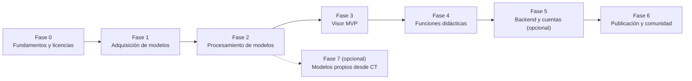
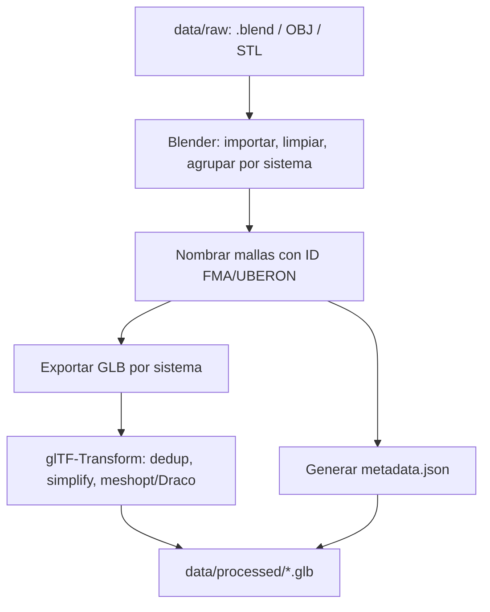
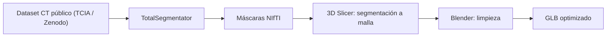

# Plan de proyecto: Visor anatómico 3D libre y propio

> Estado: v0.5 · Fases 0 a 4 cerradas (despliegue pospuesto a Fase 6) · Fecha: 2026-10-20
> Alcance: proyecto de aprendizaje, **no comercial**, con código y contenido abiertos.
> Aviso: las licencias de este documento son un resumen de lo que conozco. **Verifica la licencia en la página oficial de cada recurso antes de descargarlo**, y registra la verificación en `docs/ATTRIBUTIONS.md` (Fase 0).

---

## 0. Supuestos (cámbialos si no aplican)

| Tema | Supuesto |
|---|---|
| Plataforma | Web (navegador de escritorio primero, móvil después) |
| Stack | TypeScript + React + Three.js (react-three-fiber), Vite |
| Backend | Ninguno al inicio (sitio estático). API + BD en la Fase 5 |
| Objetivo | Aprender y publicar algo propio y libre, no competir con BioDigital |
| Idioma de UI | Español (con nombres anatómicos en latín/inglés como respaldo) |
| Presupuesto | $0 (hosting gratuito: GitHub Pages, Cloudflare Pages o Netlify) |

## 1. Objetivos y no-objetivos

**Objetivos**
1. Visor 3D interactivo del cuerpo humano con capas por sistema.
2. Selección de estructuras con nombre y descripción.
3. Búsqueda, aislar/ocultar/transparencia, y cortes (clipping).
4. Contenido didáctico propio: tours y cuestionarios.
5. Cumplir todas las licencias, con atribución visible y trazable.

**No-objetivos (por ahora)**
- Uso clínico o diagnóstico. Debe incluir un aviso de que es solo educativo.
- Patologías detalladas al nivel de BioDigital.
- Monetización.
- Datos de pacientes reales. Solo datasets públicos y anonimizados.

---

## 2. Mapa de fases



| Fase | Resultado | Duración estimada* |
|---|---|---|
| 0 | Repositorio, licencias, política de atribución | 2-3 días |
| 1 | Modelos fuente descargados y catalogados | 3-5 días |
| 2 | Modelos limpios, nombrados y comprimidos (GLB) | 1-2 semanas |
| 3 | Visor funcional con capas y selección | 2-3 semanas |
| 4 | Búsqueda, cortes, tours, cuestionarios | 3-4 semanas |
| 5 | API, BD y cuentas | 2-3 semanas |
| 6 | Sitio público, documentación, CI | 1 semana |
| 7 | Segmentación propia desde CT | 3+ semanas |

\* Estimaciones para una persona aprendiendo, a tiempo parcial. Ajústalas.

---

## FASE 0: Fundamentos y licencias

**Objetivo:** dejar el proyecto legalmente ordenado antes de tocar un solo modelo.

### Tareas
- [x] Crear repositorio Git con esta estructura:
  ```
  biologia/
  ├─ docs/                  # planificación y documentación
  │  ├─ PLAN_PROYECTO.md
  │  ├─ ATTRIBUTIONS.md     # tabla de fuentes y licencias verificadas
  │  └─ DECISIONES.md       # registro de decisiones técnicas (ADR cortos)
  ├─ data/
  │  ├─ raw/                # descargas originales (NO se editan)
  │  ├─ processed/          # modelos procesados
  │  └─ metadata/           # CSV/JSON de estructuras
  ├─ scripts/               # automatización (Python/Node)
  ├─ web/                   # aplicación frontend
  └─ LICENSE-CODE, LICENSE-CONTENT
  ```
- [x] Decidir **licencia del código** y **licencia del contenido** por separado (ver 2.1).
- [x] Crear `docs/ATTRIBUTIONS.md` con columnas: *Recurso, Autor, URL, Licencia, Fecha de verificación, Archivo local, Modificaciones, Obligaciones*.
- [x] Plantilla `data/raw/SOURCE.template.txt` creada (se copia como `SOURCE.txt` en cada descarga) · Añadir en `data/raw/` un archivo `SOURCE.txt` por cada descarga, con URL, fecha y hash SHA-256.
- [x] Aviso legal/educativo incluido en `README.md` (el del pie del sitio se hará en la Fase 3).

### 2.1 Estrategia de licencias del proyecto

| Componente | Licencia recomendada | Motivo |
|---|---|---|
| Código propio | **MIT** o **Apache-2.0** (o **AGPL-3.0** si quieres forzar que las mejoras sean libres) | Compatible con las dependencias (MIT/BSD/Apache) |
| Modelos 3D derivados de Z-Anatomy / BodyParts3D | **CC BY-SA 4.0** (obligatoria por ShareAlike) | Las obras derivadas deben usar la misma licencia |
| Textos propios (descripciones, cuestionarios) | **CC BY 4.0** o **CC BY-SA 4.0** | Si copias texto de Wikipedia debe ser CC BY-SA |
| Documentación | CC BY 4.0 | Simple |

> **Regla de oro:** mantén el **código** y el **contenido** en carpetas y licencias separadas. Así la cláusula ShareAlike del contenido no "contagia" tu código.

### Entregable
Repositorio inicial + `ATTRIBUTIONS.md` vacío pero con formato + licencias elegidas.

---

## FASE 1: Adquisición de modelos (diseños) y fuentes

**Objetivo:** conseguir geometría anatómica con licencia que permita uso libre, modificación y redistribución.

### 1.1 Fuentes primarias (recomendadas)

| # | Fuente | Qué aporta | Licencia verificada (2026-10-20) | Obligaciones |
|---|---|---|---|---|
| 1 | **Z-Anatomy** (z-anatomy.com, GitHub: Z-Anatomy) | `TA2.csv` como referencia de nombres; **mallas descartadas** por incluir modelos CC BY-NC / CC BY-NC-SA (ver D-004) | **CC BY-SA 4.0** (con partes NC excluidas) | Solo consulta de términos; no redistribuir mallas ni tabla TA2 completa |
| 2 | **BodyParts3D** (DBCLS, Japón; Anatomography) | Más de 1.500 mallas (OBJ) con ids de la **FMA** (árboles IS-A y PART-OF) | **CC BY 4.0** (actualizada 2025-02-27) | Atribución a "The Database Center for Life Science" e indicar cambios |
| 3 | **HuBMAP Human Reference Atlas, 3D Reference Object Library** | Órganos de referencia masculinos y femeninos en GLB con metadatos y ontologías (`crosswalk.csv` UBERON/FMA) | **CC BY 4.0** | Atribución a HuBMAP CCF 3D Reference Object Library + cita por órgano |
| 4 | **NIH 3D** (3d.nih.gov) | Modelos de ciencias de la salud, de varios autores | **Varía por modelo** (CC0, CC BY, dominio público...) | Revisar cada modelo; evitar los NC o ND |

> **Decisión Fase 1 (D-004):** Usamos **BodyParts3D v4.0** y **HuBMAP 3D Reference Organs** (ambos CC BY 4.0) como fuentes de geometría 3D, y `TA2.csv` de Z-Anatomy solo para consulta de nomenclatura.

### 1.2 Fuentes secundarias (opcionales)

| Fuente | Uso | Cuidado |
|---|---|---|
| **Visible Human Project** (NLM) | Cortes reales para texturas o segmentación | Requiere aceptar el acuerdo de licencia de la NLM. Léelo antes de redistribuir |
| **TCIA** (The Cancer Imaging Archive) | CT/MRI para la Fase 7 | La licencia **varía por colección** (CC BY 3.0/4.0 o CC BY-NC). Evita datasets con restricciones que no entiendas |
| **TotalSegmentator dataset** (Zenodo) | CT anotados con 100+ estructuras | Verifica la licencia del dataset (publicado con CC BY 4.0, confirmar) |
| **Sketchfab** | Modelos sueltos | **Solo** filtrar por CC0 / CC BY / CC BY-SA. Revisa cada uno |
| **Wikimedia Commons** | Imágenes y algunos modelos | Cada archivo tiene su licencia |

### 1.3 Qué evitar
- Modelos de **BioDigital, Visible Body, Complete Anatomy, Zygote/TurboSquid, 3D4Medical**: son propietarios. **No extraigas ni uses sus modelos**, aunque puedas verlos en el navegador.
- Cualquier recurso con licencia **NC** (no comercial) o **ND** (sin derivadas) si vas a modificar y redistribuir.
- Recursos sin licencia explícita: se asume "todos los derechos reservados".
- Modelos de cuerpo basados en escaneos de personas identificables sin consentimiento claro.

### 1.4 Ontologías y terminología (para nombres e IDs)

| Recurso | Uso | Licencia (a verificar) |
|---|---|---|
| **FMA** (Foundational Model of Anatomy) | IDs y jerarquía anatómica | CC BY 3.0 |
| **UBERON** | Ontología de anatomía multiespecie | CC BY 3.0 |
| **Terminologia Anatomica** | Nombres oficiales | Los nombres se pueden citar, pero **no copies tablas completas**. Usa FMA/UBERON como columna vertebral |

Puedes consultar UBERON/FMA con el servicio **EMBL-EBI OLS** (hay un skill disponible en este entorno).

### 1.5 Fuentes de texto didáctico

| Fuente | Licencia | Notas |
|---|---|---|
| **Wikipedia (es/en)** | CC BY-SA 4.0 | Se puede reutilizar con atribución y ShareAlike |
| **OpenStax Anatomy & Physiology** | CC BY 4.0 | Libro completo, ideal para descripciones |
| **Gray's Anatomy (1918)** | Dominio público | Texto y láminas antiguas, con terminología desactualizada |
| **Redacción propia** | La que elijas | Lo más limpio legalmente, y aprendes más |

### Tareas
- [x] Descargar referencia de Z-Anatomy (`TA2.csv`, `License.txt`, `Readme.md`; sin mallas por D-004) en `data/raw/z-anatomy/`.
- [x] Descargar el conjunto de BodyParts3D de referencia (`isa_BP3D_4.0_obj_99.zip`, `partof_BP3D_4.0_obj_99.zip` y tablas) en `data/raw/bodyparts3d/`.
- [x] Descargar los órganos de HuBMAP (masculinos y femeninos en `.glb` + `crosswalk.csv`) en `data/raw/hubmap/`.
- [x] Por cada descarga: `SOURCE.txt` con URL, fecha, versión, hash y **captura/copia del texto de licencia**.
- [x] Rellenar `ATTRIBUTIONS.md`.
- [x] Catalogar en `data/metadata/sources.csv`.

### Criterio de salida
Toda malla en `data/raw/` tiene su licencia documentada y compatible con tu plan (CC BY / CC BY-SA / CC0 / dominio público).

---

## FASE 2: Procesamiento de modelos

**Objetivo:** convertir las fuentes en un conjunto **ligero, nombrado y consistente** que cargue rápido en el navegador.

### 2.1 Herramientas (todas libres)

| Herramienta | Uso | Licencia |
|---|---|---|
| **Blender** | Abrir `.blend`, limpiar, reorganizar, exportar GLB | GPL (los modelos exportados no heredan GPL) |
| **glTF-Transform** (CLI/Node) | Optimizar, deduplicar, comprimir | MIT |
| **gltfpack / meshoptimizer** | Simplificar y comprimir mallas | MIT |
| **Draco** | Compresión de geometría | Apache-2.0 |
| **MeshLab** | Reparar y decimar mallas | GPL |
| **Python (trimesh, pandas)** | Scripts de catalogación | MIT / BSD |

### 2.2 Pipeline



### 2.3 Convenciones

- **Un GLB por sistema**: `skeletal.glb`, `muscular.glb`, `circulatory.glb`, `nervous.glb`, `digestive.glb`, `respiratory.glb`, `urinary.glb`, `reproductive.glb`, `lymphatic.glb`, `integumentary.glb`.
- Nombre de cada malla: `FMA12345_Femur_R` (ID estable + nombre + lado).
- Metadatos por estructura en `metadata.json`:
  ```json
  {
    "id": "FMA9611",
    "meshName": "FMA9611_Femur_R",
    "nameLa": "Femur",
    "nameEs": "Fémur",
    "nameEn": "Femur",
    "system": "skeletal",
    "parentId": "FMA24474",
    "side": "right",
    "source": "z-anatomy",
    "license": "CC BY-SA 4.0",
    "descriptionEs": ""
  }
  ```
  (los IDs son ilustrativos: verifícalos contra FMA)
- **Presupuesto de rendimiento:** total ≤ 30-50 MB comprimido para la carga inicial; cargar el resto bajo demanda (lazy loading por sistema).
- Colores y materiales unificados por sistema.

### Tareas
- [x] Agrupar las 2.234 mallas de BodyParts3D en las 1.658 estructuras FMA únicas y clasificarlas en los 10 sistemas anatómicos (`scripts/fase2_construir_glb.py`, sin depender de Blender; ver D-006).
- [x] Script de exportación (`scripts/fase2_construir_glb.py`) para generar un GLB por sistema (`skeletal.glb`, `muscular.glb`, `circulatory.glb`, `nervous.glb`, `digestive.glb`, `respiratory.glb`, `urinary.glb`, `reproductive.glb`, `lymphatic.glb`, `integumentary.glb`) en metros `Y-up`.
- [x] Pipeline de optimización con glTF-Transform + `meshoptimizer` (`EXT_meshopt_compression` + `KHR_mesh_quantization`) en `scripts/optimize.mjs` (137,55 MB → **34,65 MB** totales).
- [x] Generar `data/processed/metadata.json` con IDs FMA, `meshName`, `nameEn`, `nameLa`, `nameEs` (cruzando `TA2.csv`), `system`, `parentId`, `side` y el catálogo de 87 órganos de referencia de HuBMAP.
- [x] Validar cada GLB con `gltf-validator` (**0 errores y 0 avisos** en los 10 GLB).
- [x] Anotar en `ATTRIBUTIONS.md` las **modificaciones realizadas** (requisito de CC BY 4.0).
- [x] Añadir `asset.copyright` y `asset.extras` con licencia y créditos dentro de cada glTF.

### Criterio de salida
10 GLB optimizados + `metadata.json` válido, con peso dentro del presupuesto.

---

## FASE 3: Visor MVP

**Objetivo:** una página web donde se vea el cuerpo, se pueda manipular y seleccionar.

### 3.1 Stack

| Capa | Opción | Licencia |
|---|---|---|
| Build | Vite + TypeScript | MIT |
| UI | React | MIT |
| 3D | three.js + @react-three/fiber + drei | MIT |
| Estado | Zustand | MIT |
| Estilos | Tailwind CSS (o CSS Modules) | MIT |
| Tests | Vitest + Playwright | MIT / Apache-2.0 |

*Alternativa:* Babylon.js (Apache-2.0), con más herramientas integradas.

### 3.2 Funciones del MVP
1. Carga de GLB por sistema, con barra de progreso.
2. Cámara orbital (rotar, zoom, desplazar), con botones de vistas (frontal, posterior, lateral).
3. **Panel de capas:** activar/desactivar y ajustar opacidad por sistema.
4. **Selección por clic** (raycasting): resaltar la estructura y mostrar su nombre.
5. Panel lateral con ficha de la estructura (nombre ES/LA/EN, sistema, descripción).
6. Aislar, ocultar, restablecer.
7. **Créditos y licencias** accesibles desde la UI (pie de página y página `/creditos`).

### 3.3 Arquitectura del frontend

```
web/src/
├─ components/   (Viewer, LayerPanel, InfoPanel, SearchBar)
├─ three/        (loaders, picking, materiales, clipping)
├─ store/        (estado: capas, selección, cámara)
├─ data/         (carga de metadata.json)
└─ pages/        (Home, Creditos, Acerca)
```

### Tareas
- [x] Inicializar `web/` con Vite + React + TS (`web/package.json`, `web/vite.config.ts`).
- [x] Cargar los 10 GLB por sistema con `GLTFLoader` + `MeshoptDecoder`, luces e iluminación de estudio (`web/src/three/AnatomyCanvas.tsx`).
- [x] Implementar raycasting (selección por clic y hover) y resaltado emisivo.
- [x] Panel de capas conectado al estado (`web/src/components/LayerPanel.tsx`) + selector de los 87 órganos de HuBMAP y corte axial (plano Y).
- [x] Panel de información leyendo `metadata.json` (`web/src/components/InfoPanel.tsx`) con buscador en ES/LA/EN/FMA, aislar, ocultar y restablecer.
- [x] Modal y pie de créditos/licencias generados con las atribuciones verificadas (`web/src/components/CreditsModal.tsx`).
- [ ] Despliegue de prueba en hosting gratuito *(pospuesto para la Fase 6 por decisión del usuario D-009, cuando se definan las rutas de archivos procesados/raw en producción)*.

### Criterio de salida
Se puede abrir el sitio, navegar el cuerpo, ocultar sistemas y ver la ficha de una estructura con su atribución.

---

## FASE 4: Funciones didácticas

**Objetivo:** convertir el visor en una herramienta de estudio.

| Función | Descripción | Técnica |
|---|---|---|
| Búsqueda | Por nombre en ES/LA/EN, con autocompletado | Filtro reactivo en `InfoPanel.tsx` y en el árbol |
| Jerarquía | Árbol de estructuras (sistema → estructura) | Pestaña **Árbol** en `LayerPanel.tsx` |
| Cortes | Planos de corte axial/sagital/coronal | `clippingPlanes` de three.js (Y, X, Z + inversión) |
| Etiquetas | Líneas guía / pines con texto anclado a 3D | `@react-three/drei` `Html` (`Pines 3D`) |
| Tours | Secuencias de cámara + estructuras resaltadas + texto | `ANATOMY_TOURS` (4 recorridos guiados en `didacticData.ts`) |
| Cuestionarios | "Haz clic en el fémur", opción múltiple | `ANATOMY_QUIZZES` (2 cuestionarios interactivos en `didacticData.ts`) |
| Modo oscuro / accesibilidad | Teclado (`R`, `I`, `H`, `L`, `Esc`), tema claro/oscuro | Variables CSS `[data-theme="light"]` + ARIA |
| Idioma | 100 % en español con respaldo en latín (TA2) e inglés (FMA/UBERON) | `traductor_es.py` + `actualizar_metadata_es.py` |

### Contenido
- Redactar descripciones breves para **al menos 100 estructuras clave** (huesos largos, músculos principales, corazón, pulmones, hígado, riñones, encéfalo...).
- Fuentes permitidas: redacción propia, OpenStax (CC BY 4.0), Wikipedia (CC BY-SA 4.0, con atribución).
- Cada texto registra su fuente en `metadata.json` (`descriptionSource`).

### Tareas
- [x] Redactar descripciones anatómicas y fisiológicas detalladas en español para **115+ estructuras clave** (`DESCRIPCIONES_CLAVE` en `scripts/traductor_es.py`) y registrar `descriptionSource` en `data/processed/metadata.json`.
- [x] Implementar **3 planos de corte anatómico** simultáneos (**Axial Y**, **Sagital X**, **Coronal Z**) con botón de inversión de semiespacio en `LayerPanel.tsx` y `AnatomyCanvas.tsx`.
- [x] Incorporar explorador de **Árbol anatómico jerárquico** por sistema con filtro instantáneo y control individual de visibilidad (`LayerPanel.tsx`).
- [x] Añadir **Pines / etiquetas 3D flotantes** (`@react-three/drei` `<Html>`) sobre puntos anatómicos clave y sobre la estructura seleccionada (`AnatomyCanvas.tsx`).
- [x] Crear **4 Tours guiados** paso a paso (*1. Corazón y grandes vasos*, *2. Esqueleto axial y apendicular*, *3. Encéfalo y SNC*, *4. Anatomía visceral y pélvica femenina ♀*) en `web/src/data/didacticData.ts` y su reproductor en `InfoPanel.tsx`.
- [x] Crear **2 Cuestionarios interactivos (Modo Quiz)** combinando preguntas de clic directo sobre el modelo 3D (`find3d`) y opción múltiple (`multipleChoice`) con pistas, explicación y puntuación final.
- [x] Añadir conmutador de **Tema Oscuro / Claro** y atajos de teclado (`R` restablecer, `I` aislar, `H` ocultar, `L` pines 3D, `Esc` deseleccionar).

### Criterio de salida
Al menos 3 tours y 2 cuestionarios funcionales, búsqueda y cortes operativos.

---

## FASE 5: Backend y cuentas (opcional)

**Objetivo:** guardar progreso, notas y resultados.

- API: **FastAPI** (MIT) o **Node + Fastify** (MIT).
- BD: **SQLite** al inicio, luego **PostgreSQL**.
- Autenticación: sesiones propias o un proveedor libre/autohospedable.
- Funciones: guardar vistas, notas por estructura, historial de cuestionarios.
- Privacidad: guarda lo mínimo, explica qué datos almacenas, sin analítica invasiva.

### Avance
- [x] API **Node + Fastify** en `server/` con **SQLite** (`node:sqlite`) (D-011).
- [x] Cuestionarios guardados en BD: listar, crear, editar y borrar desde la web (editor manual).
- [x] Generador automático de cuestionarios a partir de `metadata.json` (clic 3D, opción múltiple o mixto).
- [x] Generador por niveles (básico, intermedio y avanzado) con el tamaño y la región calculados desde los GLB, varias plantillas y distractores parecidos (D-012).
- [x] Columna `user_id` en cuestionarios e intentos, preparada para las cuentas (migración v2, D-012).
- [x] Historial de intentos por cuestionario (sin cuentas todavía).
- [x] Corrección de los errores del quiz: puntos indebidos y respuestas visibles antes de contestar.
- [x] Autenticación y cuentas de usuario: registro, login, sesiones, roles admin/docente/estudiante y panel de administración (D-013).
- [x] Cuestionarios privados por usuario; docentes y administradores publican (D-013).
- [x] Guardar vistas (cámara y estado de la escena) y notas privadas por estructura (D-014).
- [x] Página de privacidad (qué datos se guardan) y borrado de cuenta desde Mi perfil (D-013).
- [x] Que un docente vea los resultados de sus alumnos en sus cuestionarios: por alumno y por pregunta (D-014).
- [x] Soporte de PostgreSQL además de SQLite, con script de migración de datos y tests en ambos motores (D-016).

### Criterio de salida
Un usuario puede registrarse, guardar una vista y recuperar sus resultados. **Cumplido (D-014).**

---

## FASE 6: Publicación y comunidad

- Hosting estático (GitHub Pages / Cloudflare Pages / Netlify) y CDN para los GLB.
- CI/CD con GitHub Actions: lint, tests, validación de GLB, verificación de que `ATTRIBUTIONS.md` cubra todos los archivos de `data/`.
- `README.md` con capturas, instrucciones de ejecución y licencias.
- `CONTRIBUTING.md` con reglas de licencia para aportes de contenido.
- Aviso educativo (no sustituye consejo médico) visible en el sitio.
- Repositorio público con las dos licencias (código y contenido).

### Lista de verificación legal antes de publicar
- [ ] Cada modelo tiene atribución visible: título, autor, fuente, licencia y enlace.
- [ ] Se indican las modificaciones realizadas.
- [ ] Los derivados de CC BY-SA se publican bajo CC BY-SA 4.0.
- [ ] Se incluye copia o enlace de cada licencia.
- [ ] No hay material NC/ND ni propietario mezclado.
- [ ] Los textos copiados cumplen su licencia (Wikipedia: BY-SA).
- [ ] No hay marcas ni logotipos de terceros que sugieran respaldo.

---

## FASE 7 (opcional): Modelos propios desde CT/MRI

**Objetivo:** aprender el flujo de imagen médica generando mallas propias.



| Herramienta | Licencia (a verificar) |
|---|---|
| **TotalSegmentator** | Código Apache-2.0. Algunos modelos de tareas específicas pueden tener restricciones comerciales; en uso no comercial no te afecta, pero léelo |
| **3D Slicer** | Licencia estilo BSD |
| **Cornerstone3D / VTK.js** | MIT / BSD |

Reglas:
- Usa únicamente datasets públicos y anonimizados, con licencia verificada.
- Evita colecciones con licencia que prohíba redistribuir derivados.
- Registra el dataset, su licencia y la versión del modelo de segmentación en `ATTRIBUTIONS.md`.

---

## 3. Riesgos y mitigación

| Riesgo | Impacto | Mitigación |
|---|---|---|
| Mezclar material con licencias incompatibles | Alto | Fase 0 y 1: registro estricto, revisión previa |
| Modelos demasiado pesados | Medio | Compresión, LOD y carga por sistema (Fase 2) |
| Nombres anatómicos inconsistentes | Medio | IDs FMA/UBERON como clave primaria |
| Alcance excesivo | Alto | MVP primero. Las fases 5 y 7 son opcionales |
| Errores en el contenido médico | Medio | Fuentes abiertas fiables, aviso educativo, revisión por un docente o estudiante avanzado |
| Cambios de licencia en el origen | Bajo | Guardar copia de la licencia y fecha de verificación |

## 4. Definición de "hecho" por fase

Cada fase se cierra solo si:
1. Los entregables existen y están versionados.
2. `ATTRIBUTIONS.md` está al día.
3. Hay una nota en `docs/DECISIONES.md` si hubo cambios de rumbo.

## 5. Próximos pasos inmediatos (Fase 3: Visor MVP)

1. Inicializar `web/` con Vite + React + TypeScript + `@react-three/fiber` + `@react-three/drei` + `zustand`.
2. Configurar el decodificador `MeshoptDecoder` en el cargador glTF para cargar los 10 `.glb` comprimidos de `data/processed/`.
3. Implementar el panel de capas por sistema, selección por clic (raycasting) y panel de ficha anatómica leyendo `data/processed/metadata.json`.
